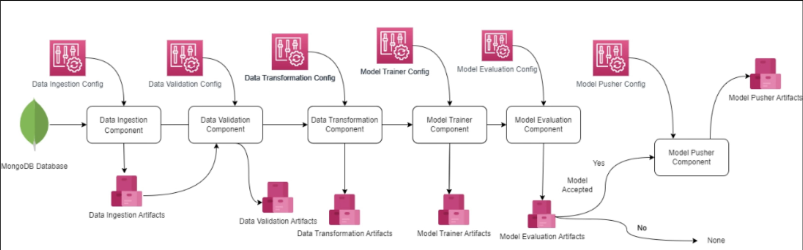
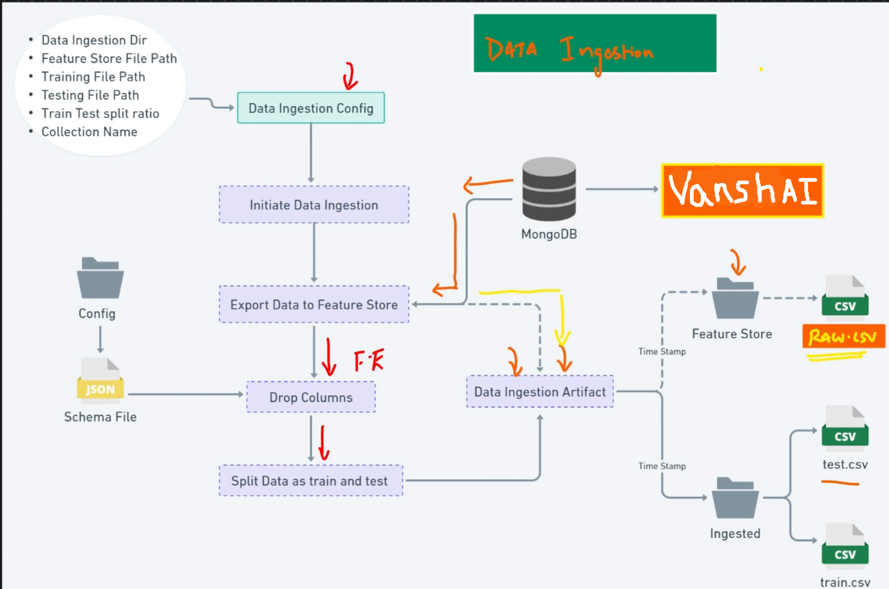
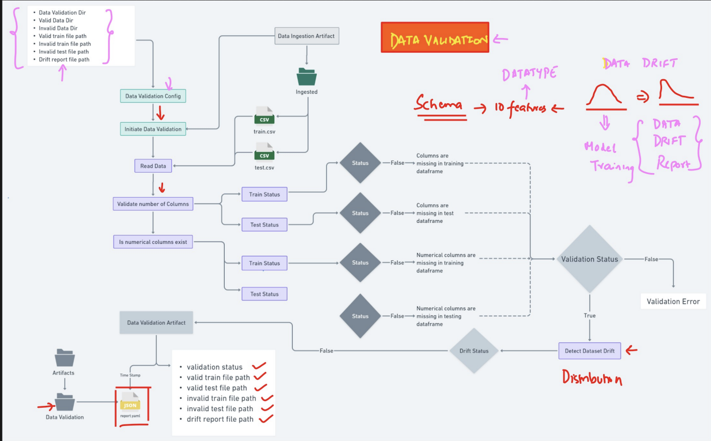
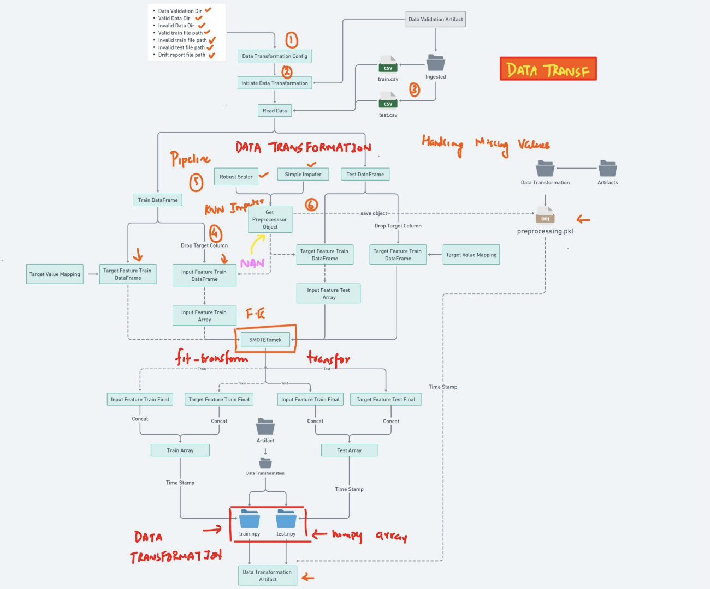
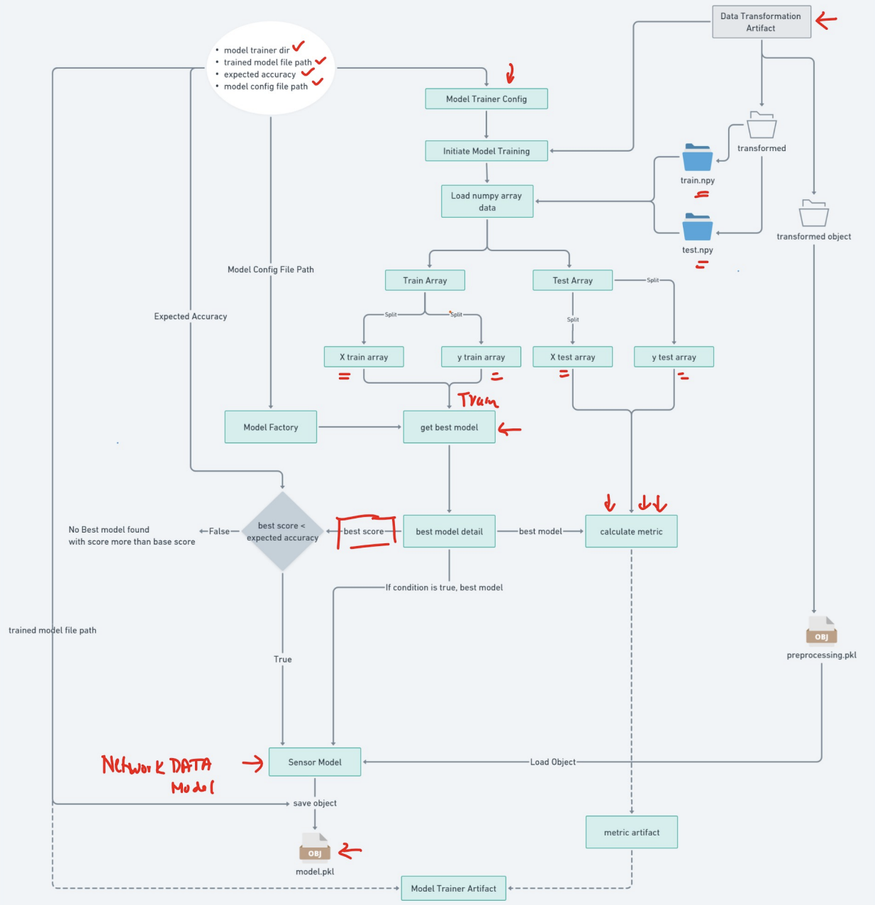

# Network Security Data - End-to-End Machine Learning Project

## Table of Contents
- [Overview](#overview)
- [Project Structure](#project-structure)
- [Pipeline Components](#pipeline-components)
  - [Data Ingestion](#data-ingestion)
  - [Data Validation](#data-validation)
  - [Data Transformation](#data-transformation)
  - [Model Training](#model-training)
- [MLFlow & Dagshub](#mlflow--dagshub)
- [FastAPI Interface](#fastapi-interface)
- [Setup](#setup)
- [Usage](#usage)
- [License](#license)

## Overview
This project is an end-to-end Machine Learning pipeline designed for Network Security Data analysis. The pipeline involves data ingestion from a MongoDB database, data validation, transformation, model training, evaluation, and model deployment. The objective is to predict network security events using a trained machine learning model.

Key components used in this project:
- **Database**: MongoDB
- **Experiment Tracking**: MLFlow
- **Remote Repository**: Dagshub
- **Web Interface**: FastAPI

## Project Structure

The checked-in source layout is:

```text
NetworkSecurity/
├── .github/workflows/
├── Network_Data/phisingData.csv
├── data_schema/schema.yaml
├── final_models/
│   ├── model.pkl
│   └── preprocessor.pkl
├── images/
├── networksecurity/
│   ├── components/
│   ├── constant/
│   ├── entity/
│   ├── exception/
│   ├── logging/
│   ├── pipeline/
│   └── utils/
│       ├── main_utils/
│       └── ml_utils/
├── prediction_output/
├── templates/
├── app.py
├── main.py
├── push_data.py
├── requirements.txt
└── setup.py
```

The training pipeline writes timestamped run artifacts under `Artifacts/` when it executes; those are runtime outputs rather than a checked-in source directory. The architecture image below is stored in this repository so the documentation does not depend on another project.



# Pipeline Components

## Data Ingestion

The Data Ingestion phase is crucial for setting up the initial dataset required for the Machine Learning workflow. This step ingests data from a MongoDB database and structures it for further processing. Below is a breakdown of the Data Ingestion process:



#### Key Steps:

1. **Configuration:**
   - The **Data Ingestion Config** specifies various paths:
     - **Data Ingestion Directory**: Directory where the ingested data will be stored.
     - **Feature Store File Path**: Path for the feature store which holds the raw data.
     - **Training and Testing File Paths**: Paths where training and testing datasets will be saved.
     - **Collection Name**: Name of the MongoDB collection from which data will be ingested.
     - **Train-Test Split Ratio**: Defines the proportion of data allocated for training versus testing.
2. **Initiate Data Ingestion:**
   - The process begins by calling the data ingestion function, which connects to the specified MongoDB database.

3. **Export Data to Feature Store:**
   - The data is exported to the feature store as a CSV file. This is the raw data and serves as the baseline for all subsequent processes.
4. **Data Ingestion Artifact:**
   - Finally, a **Data Ingestion Artifact** is created to maintain metadata about the ingestion process, including timestamps and paths to the ingested files.

#### Output:
- The end result of the Data Ingestion process is the creation of:
  - **Feature Store** containing the raw dataset as CSV.
  - **Ingested Data** folders containing `train.csv` and `test.csv` files for subsequent processing.

This structured approach ensures that the data flow into the pipeline is efficient, clean, and well-documented, providing a strong foundation for further stages of the data processing pipeline.

## Data Validation

The Data Validation phase ensures that the ingested data meets the necessary quality standards before proceeding to the next steps in the Machine Learning pipeline. The following diagram outlines the key aspects of this process:



### Overview of the Process:

1. **Configuration**:
   - The process starts with a **Data Validation Config** that defines directories for valid and invalid data, as well as paths for drift reports.

2. **Initiate Validation**:
   - Data validation is initiated, starting with reading the ingested CSV files (`train.csv` and `test.csv`).

3. **Column Validation**:
   - The number of columns and their data types is validated against the predefined schema. This includes checks to ensure the correct columns are present and that numerical columns exist.

4. **Validation Status**:
   - The validation status is recorded, indicating whether any columns are missing or if there are issues with the data types.

5. **Dataset Drift Detection**:
   - If the initial validation passes, the process checks for dataset drift, which helps ensure that the data remains consistent with the training parameters.

6. **Data Validation Artifact**:
   - Finally, a **Data Validation Artifact** is created, summarizing the validation status and producing a drift report in JSON format.


## Data Transformation

The Data Transformation phase prepares the validated data for modeling by handling missing values and scaling features. The following diagram illustrates the key steps in this process:



### Overview of the Process:

1. **Configuration**:
   - The process begins with a **Data Transformation Config**, which sets the parameters for the transformation pipeline.

2. **Initiate Data Transformation**:
   - The data transformation process is initiated, starting with the reading of the validated CSV files (`train.csv` and `test.csv`).

3. **Feature Handling**:
   - Missing values in the dataset are handled using techniques such as Robust Scaling and KNN Imputer. The target column is dropped from the training data to prepare for transformation.

4. **Data Preparation**:
   - The training and testing data are converted into feature arrays, preparing for input into the ML model. Techniques like SMOTE are applied to address imbalances in the data.

5. **Concatenation and Finalization**:
   - The final transformed training and testing arrays are created and concatenated accordingly.

6. **Artifact Creation**:
   - The transformation includes saving a preprocessor object (`preprocessing.pkl`) and the resulting numpy arrays (`train.npy` and `test.npy`) as artifacts for future use.


## Model Training

The Model Training phase is vital for building and optimizing a machine learning model based on the transformed data. The following diagram illustrates the core steps involved in this process:



### Overview of the Process:

1. **Configuration**:
   - The process begins with a **Model Trainer Config** that defines parameters such as model file paths and expected accuracy.

2. **Initiate Model Training**:
   - Model training is initiated by loading the transformed numpy arrays (`train.npy` and `test.npy`) for further processing.

3. **Data Preparation**:
   - The training and testing arrays are prepared by splitting the features and target values, ensuring the data is structured for model input.

4. **Model Selection**:
   - Multiple models are evaluated, including:
     - Random Forest
     - Decision Tree
     - Gradient Boosting
     - Logistic Regression
     - AdaBoost
   - GridSearchCV is utilized for hyperparameter tuning to find the best combination of parameters for each model.

5. **Model Evaluation**:
   - The best-performing model is selected based on evaluation metrics, including the best score compared to the expected accuracy.

6. **Artifact Creation**:
   - After training, the best model is saved as an object (`model.pkl`) along with associated metrics, which are logged for future reference.

## MLFlow & Dagshub

In this project, MLFlow and Dagshub are utilized for effective tracking of experiments, model performance, and version control. These tools enhance the reproducibility and maintainability of the machine learning workflow.

The training module initializes MLflow tracking for the DagsHub project `SamyakAnand/NetworkSecurity`. Set up and authorize that project in your own DagsHub account before running training; keep access tokens in environment variables, never in source files.

### MLFlow

MLFlow is an open-source platform designed for managing the machine learning lifecycle. It provides various components including:

- **Experiment Tracking**: MLFlow allows tracking of model training runs, parameters, metrics, and artifacts. Each experiment is recorded, making it easy to compare model performance over time.
- **Model Repository**: Models can be logged and later retrieved for deployment or further analysis. The built-in tracking server stores all experiment details in one place.

### Key Features of MLFlow in this Project:
- Logging of hyperparameters and metrics during model training.
- Storage of trained model files for easy retrieval.
- Visualization tools for comparing different runs and determining the best-performing model.

### Dagshub

Dagshub serves as a remote repository tailored for data science and machine learning projects. It integrates well with Git and supports versioning for datasets, code, and model files.

### Key Features of Dagshub in this Project:
- **Version Control**: Facilitates tracking changes in datasets and code, allowing team collaboration and versioning for reproducibility.
- **Experiment Management**: Dagshub provides a platform for storing and comparing different experiments, complements MLFlow’s capabilities by preserving all components of the workflow in a single location.

### Integration
In this project, both MLFlow and Dagshub are configured to work together, ensuring that every aspect of the training and evaluation process is logged and easily accessible. This integration enhances project transparency and allows for effective collaboration among team members.


## FastAPI Interface

The FastAPI framework is used to create a simple web interface for making predictions based on the trained machine learning model. This interface allows users to input data and receive predictions, facilitating easy interaction with the model.

### Key Features:
- **RESTful API**: FastAPI provides a RESTful interface to interact with the model, making it accessible for various applications.
- **Data Validation**: Incoming requests are validated automatically, ensuring that the data format aligns with the expected schema.
- **Asynchronous Support**: FastAPI leverages asynchronous programming, improving performance for handling multiple requests.

### How to Run:
To start the FastAPI application, run the following command in your terminal:
```bash
uvicorn app:app --reload
```
This will start the server locally, and you can access the interface at `http://127.0.0.1:8000/docs` to view the available endpoints.

---

## Setup

To set up the environment for this project, follow the steps below:

1. **Clone the Repository**:
   ```bash
   git clone https://github.com/SamyakAnand/NetworkSecurity
   cd NetworkSecurity
   ```

2. **Install Dependencies**:
   Use the provided `requirements.txt` file to install the necessary packages:
   ```bash
   pip install -r requirements.txt
   ```

3. **Update Dagshub Credentials**:
   In `networksecurity/components/model_trainer.py`, change the DagsHub owner and repository name only if you are using a different remote:
   ```python
   dagshub.init(repo_owner=<your username>, repo_name=<your repo name>, mlflow=True)
   ```

4. **Set Up MongoDB**:
   Ensure that you have a MongoDB instance running and accessible. In the main function of the file `push_data.py`, update your MongoDB credentials as follows:
   ```python
   FILE_PATH = "Network_Data/phisingData.csv"
   DATABASE = <Your database name>
   collection = <Your collection name>
   ```

   Additionally, create a `.env` file in the root directory of the project and add your MongoDB URL:
   ```plaintext
   MONGO_DB_URL=your_mongodb_connection_string
   # Optional comma-separated exact HTTP(S) origins; leave blank for same-origin only.
   CORS_ORIGINS=
   ```

5. **Environment Variables**:
   - `MONGO_DB_URL` is used by the ingestion script and FastAPI application.
   - `MONGODB_URL_KEY` remains accepted as a backward-compatible alias.
   - `CORS_ORIGINS` is optional. Leave it empty for same-origin access, or provide a comma-separated allowlist such as `https://dashboard.example.com,http://localhost:3000`.
   - Wildcard origins are rejected and credentialed cross-origin requests are disabled.

## Security notes

- The API and ingestion script do not print MongoDB connection strings.
- Uploaded CSV rows and prediction values are not written to application logs.
- Cross-origin access is disabled by default. Configure only the exact frontend origins that need access.
- Keep `.env` local and never commit database URLs or DagsHub tokens.


## Usage

Once the setup is complete, you can use the project as follows:

1. **Push Data To MongoDB**:
   Push data to MongoDB by running the push_data script:
   ```bash
   python push_data.py
   ```


2. **Execute main pipeline**:
   Execute the main.py file to run the pipeline and all its components:
   ```bash
   python main.py
   ```

3. **Run the FastAPI Application**:
   Start the FastAPI server to make predictions:
   ```bash
   uvicorn app:app --reload
   ```

Once the server is running, you can send POST requests to the prediction endpoint to receive outputs based on input data.

## License

This project is licensed under the MIT License. See the [LICENSE](LICENSE) file for more information.
